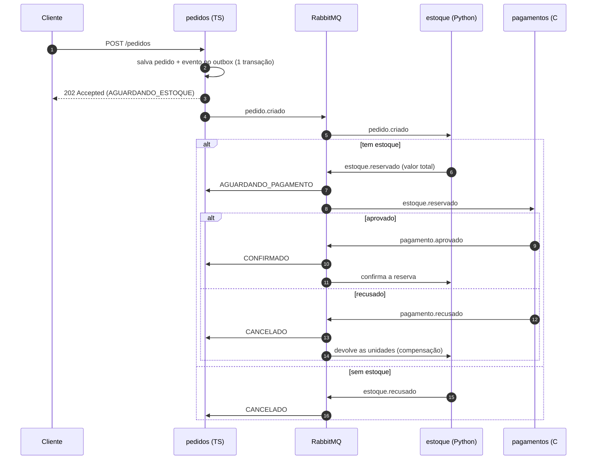

<p align="center">
  
</p>

<h1 align="center">Pedidos com Microsserviços e RabbitMQ</h1>

<p align="center"><b>Saga com compensação · Outbox transacional · Consumidores idempotentes · DLQ</b></p>

<p align="center">
  <a href="https://github.com/Kauan-V-Marques/pedidos-microsservicos/actions/workflows/ci.yml"></a>
  
  
  
  
</p>

<p align="center">
  <a href="#como-a-saga-funciona">Como a saga funciona</a> ·
  <a href="#como-rodar">Como rodar</a> ·
  <a href="#testes">Testes</a>
</p>

---

Processamento de pedidos de uma loja de componentes de robótica com **três microsserviços em três linguagens**, conversando só por eventos no **RabbitMQ**. Nenhum serviço chama outro diretamente, e cada um tem o próprio banco de dados.

O projeto mostra os padrões que mantêm um sistema distribuído consistente mesmo com falhas:

| Padrão | Para quê |
|---|---|
| **Saga por coreografia** | Um pedido envolve três serviços sem transação distribuída. Cada um reage aos eventos dos outros |
| **Compensação** | Se o pagamento é recusado, o estoque devolve as unidades que tinha reservado |
| **Transactional outbox** | O evento é gravado na mesma transação dos dados e publicado depois por um relay. Nunca existe pedido salvo sem evento, nem evento de algo que não foi salvo |
| **Consumidor idempotente (inbox)** | O RabbitMQ entrega "pelo menos uma vez". Os ids processados ficam guardados, e a mesma mensagem não tem efeito duas vezes |
| **Publisher confirms** | Uma mensagem só é dada como publicada depois que o broker confirma |
| **Dead letter queue** | Uma mensagem malformada vai direto para a fila de mortas. Um erro temporário é tentado de novo até 5 vezes (fila *quorum* com `x-delivery-limit`) e depois também vai para a DLQ |
| **Concorrência** | A reserva trava as linhas em ordem de SKU (`SELECT ... FOR UPDATE`): pedidos simultâneos nunca vendem além do estoque e não geram *deadlock* |

## Como a saga funciona



| Serviço | Linguagem | Banco | O que faz |
|---|---|---|---|
| [`pedidos`](servicos/pedidos) | TypeScript (Node 24, Fastify, amqplib) | PostgreSQL `pedidos` | API pública, máquina de estados do pedido, outbox |
| [`estoque`](servicos/estoque) | Python (FastAPI, aio-pika, psycopg) | PostgreSQL `estoque` | Reserva "tudo ou nada", confirmação, compensação, outbox |
| [`pagamentos`](servicos/pagamentos) | C# (.NET 10 Worker, RabbitMQ.Client) | sem estado | Decide o pagamento com regras determinísticas |

Regras da operadora simulada: o cartão com final `0000` é recusado, e pedidos acima de R$ 10.000 também.

## Como rodar

```bash
docker compose up --build
```

```bash
# um pedido
curl -X POST localhost:3000/pedidos -H "Content-Type: application/json" \
  -d '{"cliente":"Ana","cartao_final":"4242","itens":[{"sku":"SEN-QTR8A","quantidade":2}]}'

# acompanhar (troque pelo id devolvido)
curl localhost:3000/pedidos/<id>

# estoque
curl localhost:8000/produtos
```

O painel do RabbitMQ fica em http://localhost:15672 (usuário `loja`, senha `loja`), com as filas, as DLQs e as mensagens passando.

Exemplo de pedido concluído:

```json
{
  "status": "CONFIRMADO",
  "valor_total": 379.8,
  "itens": [{ "sku": "SEN-QTR8A", "quantidade": 2 }],
  "historico": [
    { "status": "AGUARDANDO_ESTOQUE" },
    { "status": "AGUARDANDO_PAGAMENTO", "evento": "estoque.reservado" },
    { "status": "CONFIRMADO", "evento": "pagamento.aprovado" }
  ]
}
```

## Testes

| Nível | O que é testado |
|---|---|
| **pedidos** (Vitest + PostgreSQL) | Máquina de estados (inclusive eventos fora de ordem), outbox gravado na mesma transação, mensagem repetida sem efeito duplicado, API |
| **estoque** (pytest + PostgreSQL) | Reserva tudo ou nada, produto inexistente, compensação, confirmação, idempotência, **5 pedidos simultâneos pelo mesmo kit**, mensagem malformada |
| **pagamentos** (xUnit) | Regras, limite exato, id derivado (resposta repetida tem o mesmo id), formato do envelope |
| **ponta a ponta** (docker compose) | O sistema inteiro: caminho feliz, falta de estoque, pagamento recusado com o estoque voltando, limite de valor, 6 pedidos concorrentes e mensagem malformada parando na DLQ |

No GitHub Actions, cada serviço é testado na sua linguagem e, se todos passarem, o sistema completo sobe com `docker compose` para os testes de ponta a ponta.

---

<details>
<summary>English</summary>

### Order Processing with Microservices and RabbitMQ

Three polyglot microservices (TypeScript, Python, C#/.NET) communicating only through RabbitMQ events, each with its own database. Implements a choreography **saga** with compensation, the **transactional outbox**, idempotent consumers (**inbox**), publisher confirms, **dead-letter queues** with quorum-queue delivery limits, and deterministic response ids so redeliveries are deduplicated downstream. Row locking in sorted order prevents overselling and deadlocks under concurrency. Unit/integration tests per service plus end-to-end tests against the full Docker Compose stack in CI.

</details>

---

<p align="center">
  Feito por <a href="https://github.com/Kauan-V-Marques"><b>Kauan Victor Marques</b></a> ·
  <a href="https://kauan-v-marques.github.io/curriculo/">Currículo</a> ·
  <a href="https://github.com/Kauan-V-Marques?tab=repositories">Mais projetos</a>
</p>

<p align="center">
  
</p>
